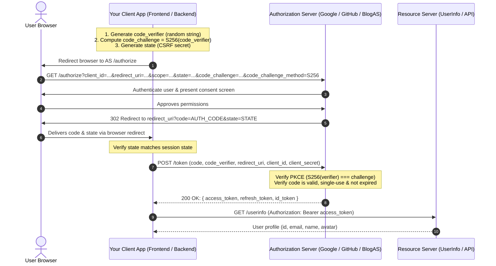
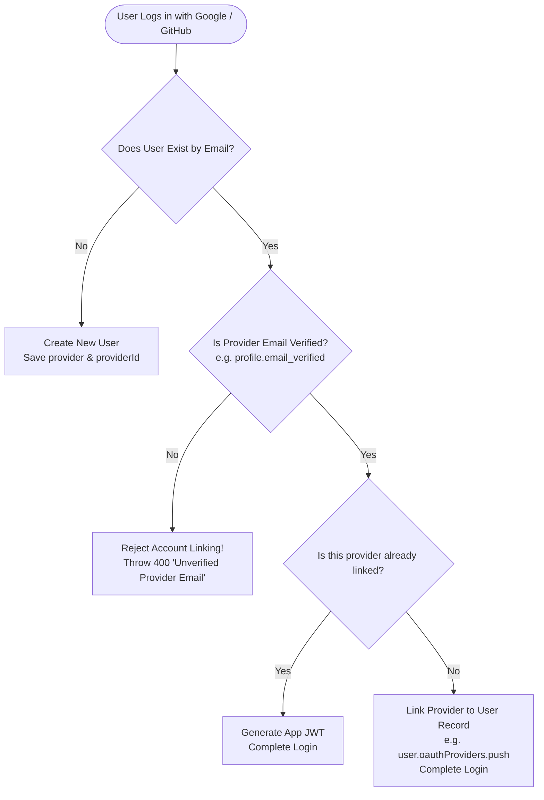

# OAuth 2.0 & 2.1 Deep Dive: Provider Internals & Third-Party Integration Guide

This guide explains the foundational mechanics of OAuth 2.0 / 2.1, bridges the gap between **being an OAuth Provider** (what is implemented in `src/modules/OAuth`) and **being an OAuth Consumer** (integrating Google, GitHub, etc.), and documents critical security rules for production.

---

## Table of Contents
1. [The OAuth Mental Model: Roles & Perspectives](#1-the-oauth-mental-model-roles--perspectives)
2. [Anatomy of the Authorization Code Flow with PKCE](#2-anatomy-of-the-authorization-code-flow-with-pkce)
3. [Deep Dive into Every Parameter & Mechanism](#3-deep-dive-into-every-parameter--mechanism)
4. [Step-by-Step: Integrating Third-Party Providers (Google, GitHub)](#4-step-by-step-integrating-third-party-providers-google-github)
5. [Account Reconciliation & Identity Linking Strategies](#5-account-reconciliation--identity-linking-strategies)
6. [Differences Between Major Providers](#6-differences-between-major-providers)
7. [Critical Production Notes & Future Review Checklist](#7-critical-production-notes--future-review-checklist)

---

## 1. The OAuth Mental Model: Roles & Perspectives

In any OAuth interaction, there are **4 distinct roles** (defined in RFC 6749):

```
+-------------------+            +--------------------+
|  Resource Owner   |            |   Client / App     |
|   (The End User)  |            |  (Consuming App)   |
+-------------------+            +--------------------+
          ^                                ^
          |                                |
+-------------------+            +--------------------+
|   Authorization   |            |  Resource Server   |
|   Server (AS)     |            | (Protected API)    |
+-------------------+            +--------------------+
```

### The Two Sides of the Coin

| Role | When YOU are the Provider (`src/modules/OAuth`) | When YOU Integrate Third Parties (Google, GitHub) |
| :--- | :--- | :--- |
| **Resource Owner** | Your registered blog user. | A person browsing your website who has a Google/GitHub account. |
| **Client** | A 3rd-party developer or mobile app accessing your blog API. | **Your Blog Backend**. |
| **Authorization Server** | **Your Backend** (`/api/v1/oauth/*`). | **Google** (`accounts.google.com`) or **GitHub** (`github.com/login/oauth`). |
| **Resource Server** | **Your Backend** (`/api/v1/blog`, `/api/v1/user`). | **Google UserInfo API** or **GitHub API** (`api.github.com/user`). |

> [!TIP]
> **Key Insight**: The exact protocol you built for your authorization server is the exact same protocol you will speak as a client when integrating Google or GitHub!

---

## 2. Anatomy of the Authorization Code Flow with PKCE

OAuth 2.1 mandates the **Authorization Code Grant with PKCE** (`S256`).



---

## 3. Deep Dive into Every Parameter & Mechanism

### 3.1. `client_id` and `client_secret`
- **`client_id`**: Public identifier for your app (safe to be in frontend code / URLs).
- **`client_secret`**: Cryptographic password known **only** by your backend and the provider.
- **Rule**: If an app cannot protect the secret (e.g., Pure React/Vue SPAs, iOS/Android mobile apps), it is a **Public Client** and **MUST NOT** hold a `client_secret`. It relies strictly on PKCE. Server-rendered or Node.js API backends are **Confidential Clients** and must authenticate with their secret.

### 3.2. `redirect_uri` (Callback URL)
- The destination URL where the Authorization Server sends the user back with the `code`.
- **Production Standard**: Must match the registered URI **byte-for-byte**.
- **Security Guard**: Never allow wildcard domains (`*.example.com`) or subpath traversal. An open redirect vulnerability on your callback URL allows attackers to steal authorization codes.

### 3.3. `state` (Cross-Site Request Forgery Protection)
- **What it is**: A high-entropy, random string generated by the Client before redirecting the user.
- **How it works**:
  1. The client saves `state` in an HTTP-only cookie or server session (Redis).
  2. The provider returns the exact same `state` in the callback query parameters (`?code=...&state=...`).
  3. The client verifies `receivedState === savedState`.
- **Why it is critical**: Without `state`, an attacker can trick an authorized user's browser into completing an OAuth exchange with the attacker's authorization code, binding the victim's session to the attacker's account.

### 3.4. PKCE (`code_verifier` and `code_challenge`)
- **RFC 7636**: Proof Key for Code Exchange.
- **Why PKCE was invented**: On native apps and browsers, custom URI schemes or history sniffing could intercept the `authorization_code`. PKCE ensures that **only the entity that initiated the request can exchange the code**.
- **The Math**:
  1. `code_verifier`: 43–128 characters from `[A-Z, a-z, 0-9, -, ., _, ~]`.
  2. `code_challenge`: `BASE64URL(SHA256(ASCII(code_verifier)))`.
  3. `code_challenge_method`: Strictly `"S256"`.
- When exchanging the code at `/token`, the client sends `code_verifier`. The server computes `SHA256(code_verifier)` and checks if it matches the `code_challenge` sent in step 1.

### 3.5. `scope`
- Space-delimited permissions requested from the user.
- **Principle of Least Privilege**: Ask only for what you need (e.g. `openid email profile`). Requesting excessive scopes increases user drop-off during consent.

### 3.6. `authorization_code`
- Short-lived string (TTL **≤ 60 seconds**).
- **Strictly Single-Use**: As soon as it is presented to `/token`, delete it atomically.
- **Replay Detection (RFC 6749 §4.1.2)**: If an authorization code is presented a second time, it indicates the code was intercepted. The authorization server **must revoke all tokens ever issued from that code**.

### 3.7. Access Token vs. Refresh Token vs. ID Token
| Token | Format | Lifetime | Purpose |
| :--- | :--- | :--- | :--- |
| **Access Token** | JWT or Opaque string | Short (15 min – 1 hr) | Sent in `Authorization: Bearer <token>` to access protected resources. |
| **Refresh Token** | Cryptographic random string | Long (14 – 90 days) | Sent to `/token` to mint a new access token without re-prompting the user. |
| **ID Token** *(OIDC)* | Signed JWT | Short (1 hr) | Proof that the user was authenticated. Contains identity claims (`sub`, `email`, `name`). |

---

## 4. Step-by-Step: Integrating Third-Party Providers (Google, GitHub)

When adding "Sign in with Google" or "Sign in with GitHub" to your backend, you act as the **Client**.

### Step 1: Register Your Application with the Provider
1. **Google**: Go to Google Cloud Console $\to$ Credentials $\to$ Create OAuth 2.0 Client ID.
   - Authorized Redirect URI: `http://localhost:5000/api/v1/auth/google/callback`
   - You get: `GOOGLE_CLIENT_ID` and `GOOGLE_CLIENT_SECRET`.
2. **GitHub**: Go to GitHub Settings $\to$ Developer Settings $\to$ OAuth Apps $\to$ New OAuth App.
   - Authorization callback URL: `http://localhost:5000/api/v1/auth/github/callback`
   - You get: `GITHUB_CLIENT_ID` and `GITHUB_CLIENT_SECRET`.

---

### Step 2: The Two Required Endpoints

You only need **two endpoints per provider** in your Express app:

```
GET /api/v1/auth/:provider          --> Generates PKCE/state, redirects user to provider
GET /api/v1/auth/:provider/callback --> Receives code/state, exchanges for profile, logs user in
```

#### Detailed Handler 1: Redirect to Provider
```typescript
import { Request, Response } from "express";
import { generateRandomToken, deriveCodeChallenge } from "../OAuth/oauth.utils";

export const initiateGoogleLogin = (req: Request, res: Response) => {
  const state = generateRandomToken(16);
  const codeVerifier = generateRandomToken(32);
  const codeChallenge = deriveCodeChallenge(codeVerifier);

  // Store in secure, HTTP-only cookies for verification in callback
  res.cookie("oauth_state", state, { httpOnly: true, secure: process.env.NODE_ENV === "production", maxAge: 10 * 60 * 1000 });
  res.cookie("oauth_verifier", codeVerifier, { httpOnly: true, secure: process.env.NODE_ENV === "production", maxAge: 10 * 60 * 1000 });

  const params = new URLSearchParams({
    client_id: process.env.GOOGLE_CLIENT_ID!,
    redirect_uri: `${process.env.BACKEND_URL}/api/v1/auth/google/callback`,
    response_type: "code",
    scope: "openid email profile",
    state: state,
    code_challenge: codeChallenge,
    code_challenge_method: "S256",
    access_type: "offline", // requests refresh_token
    prompt: "consent",
  });

  res.redirect(`https://accounts.google.com/o/oauth2/v2/auth?${params.toString()}`);
};
```

#### Detailed Handler 2: Handle Provider Callback
```typescript
export const handleGoogleCallback = async (req: Request, res: Response) => {
  const { code, state, error } = req.query;
  const savedState = req.cookies.oauth_state;
  const codeVerifier = req.cookies.oauth_verifier;

  // 1. Verify CSRF state
  if (!state || state !== savedState) {
    throw new AppError("Invalid OAuth state (CSRF detected)", 400);
  }

  // 2. Exchange authorization code for tokens
  const tokenResponse = await fetch("https://oauth2.googleapis.com/token", {
    method: "POST",
    headers: { "Content-Type": "application/x-www-form-urlencoded" },
    body: new URLSearchParams({
      code: String(code),
      client_id: process.env.GOOGLE_CLIENT_ID!,
      client_secret: process.env.GOOGLE_CLIENT_SECRET!,
      redirect_uri: `${process.env.BACKEND_URL}/api/v1/auth/google/callback`,
      grant_type: "authorization_code",
      code_verifier: codeVerifier,
    }),
  });
  const tokens = await tokenResponse.json();

  // 3. Fetch user profile using access_token
  const profileResponse = await fetch("https://www.googleapis.com/oauth2/v3/userinfo", {
    headers: { Authorization: `Bearer ${tokens.access_token}` },
  });
  const profile = await profileResponse.json();
  // profile: { sub: "109823...", email: "user@gmail.com", email_verified: true, name: "Alice" }

  // 4. Reconcile / Log in user (see Section 5)
  const appUser = await reconcileUser({
    provider: "google",
    providerId: profile.sub,
    email: profile.email,
    isEmailVerified: profile.email_verified,
    name: profile.name,
  });

  // 5. Mint your own application's JWT session token
  const appToken = mintAppJwt(appUser);
  res.redirect(`${process.env.FRONTEND_URL}/oauth/success?token=${appToken}`);
};
```

---

## 5. Account Reconciliation & Identity Linking Strategies

The most critical production decision when adding social login is: **What happens when someone logs in with Google using an email that already exists in your database?**

### The Security Rule: Never blindly link unverified emails!



### Recommended User Schema Extension for Multiple Providers

```typescript
// In your User model:
interface IOAuthProviderLink {
  provider: "google" | "github";
  providerId: string;           // Provider's unique user ID (e.g. profile.sub or github id)
  linkedAt: Date;
}

interface IUser {
  email: string;
  password?: string;            // Optional: Social-only users won't have a password!
  isVerified: boolean;
  providers: IOAuthProviderLink[]; // Supports linking both Google AND GitHub to one account
}
```

---

## 6. Differences Between Major Providers

| Feature | Google | GitHub | Apple |
| :--- | :--- | :--- | :--- |
| **Protocol** | OAuth 2.0 + OpenID Connect | OAuth 2.0 Only | OAuth 2.0 + OpenID Connect |
| **PKCE Support** | Yes (Mandatory for mobile, recommended for web) | Yes (Supported) | Yes |
| **Email Privacy** | Always returns verified email in `/userinfo` | Emails can be private! Requires separate call to `GET api.github.com/user/emails` | Can hide email behind relay (`@privaterelay.appleid.com`) |
| **User ID Field** | `sub` (string) | `id` (numeric integer) | `sub` (unique pairwise ID) |
| **Refresh Tokens** | Issued only if `access_type=offline` and `prompt=consent` | No refresh token (access tokens don't expire unless revoked) | Issues refresh tokens |

---

## 7. Critical Production Notes & Future Review Checklist

Keep this checklist handy for production readiness and code audits:

### 1. State Parameter Security
- [ ] `state` MUST be stored in an `HttpOnly`, `SameSite=Lax`, `Secure` cookie or in Redis.
- [ ] `state` must expire within 5–10 minutes.
- [ ] Never proceed with code exchange if `state` is missing or mismatching.

### 2. Account Takeover Protection
- [ ] If someone creates an account on your platform using email/password (`alice@gmail.com`) without verifying their email, and an attacker creates an unverified account on a rogue provider with `alice@gmail.com`, **DO NOT** auto-merge them! Only auto-link if `email_verified: true` is cryptographically guaranteed by the provider (like Google OIDC ID token).

### 3. Passwordless Social Users
- [ ] Users who sign up via Google or GitHub do not have a password. Ensure your `changePassword` or `login` endpoints check `if (!user.password)` and prompt them: *"This account uses Google Login. Set a password via Forgot Password first."*

### 4. PKCE Code Verifier Storage
- [ ] Do not store `code_verifier` in LocalStorage or frontend state if the callback is handled on the backend. Keep it in an HTTP-only temporary cookie alongside `state`. Clear both cookies immediately in the callback handler.

### 5. Refresh Token Rotation (RTR)
- [ ] When using refresh tokens, always enforce single-use rotation. If a previously consumed refresh token is ever received again, immediately invalidate the entire family of tokens (replay defense).

### 6. Clock Skew & JWT Verification
- [ ] When validating JWT tokens or ID tokens from providers, allow a 1-to-2 minute leeway for clock drift between servers (`clockTolerance: 60`).
